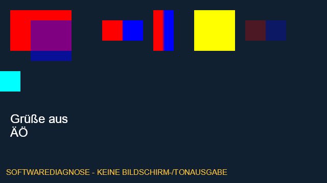

# Vorbereitete Szenen im nativen Medienprozess

Beginn 14., Abschluss 15. Oktober 2026 · [Issue #29](https://github.com/SchapfeldNils/ShowNight-System/issues/29) · `codex/s3-native-scene-composition`, auf PR #28 / `1ac77585b18e5749f6f140f2eccfbda2b74f17c6`. Teilumfang F07/F08/F09/F12/F17/F25/F28/F30, Teilnachweise A02/A04/A06/A18. F04 betrifft Dauer; die ursprüngliche falsche Zuordnung wurde korrigiert. Keine vollständige Abnahme dieser Anforderungen.

## Bedienung und Grenzen

Den vorhandenen lokalen Server mit Medienprozess starten, als Admin mit MFA anmelden, unten ein vorbereitetes Paket ansehen. Unter **Medienprozess · Softwarediagnose → Paketszene** eine Szene und **Paketszene vorbereiten** wählen. Das bisherige Diagnoseprogramm bleibt erhalten. **Diagnosebild übernehmen** übernimmt ausdrücklich die Vorschau in den stummen Diagnoseprogrammkanal. Die abgerufenen 640 × 360 PNG-Standbilder stammen aus dem nativen Prozess; die SVG-Skizze daneben bleibt ein Browserentwurf.

Manifest-v1-Pakete und ältere Renderer ohne gemeldete Szenenfähigkeit behalten den bisherigen Einzelmedienweg. Kein automatisches Update, Livepaketwechsel, Show-GO oder Replay. Dieser Durchlauf aktualisiert weder Netcup noch die installierte lokale 0.3.8. Das geprüfte finale Setup 0.3.10 liegt im Arbeits-Worktree unter `dist/streaming-installer/ShowNight-Streaming-Setup-x64.exe` und zusätzlich unter `%USERPROFILE%\Downloads\ShowNight-0.3.10`; Installation nach [Installeranleitung](s3-streaming-installer.md) erst mit Sicherung und regulär beendetem eigenem Dienst. Nicht installiert.

Text, Rechteck und Bild verwenden die bestehende Szenendefinition: Reihenfolge unten nach oben, Sichtbarkeit, Deckkraft, Koordinaten und rechteckige Begrenzungen. Die logische Leinwand wird proportional und zentriert eingepasst; übrige Fläche schwarz. PNG/JPEG mit `contain` oder `cover`. Explizite Textzeilenumbrüche mit Arial/Windows-Schriftfallback und Begrenzung auf die Textbox; keine automatische Worttrennung, Richtext-, eigene Schrift-, typografische Gleichheits- oder vollständige Editorzusage. Native Darstellung ist für diesen Weg verbindlich. Vorläufige vorhandene Gestaltung; Originaldesignquellen fehlen weiterhin.

Animationen, Video-/Kameraebenen, Gruppen, Rotation, Effekte, Full-HD/GPU/WebRTC, persönliche Regievorschau, Publikumston, HDMI/Bühnenmonitor und Showablauf bleiben Folgearbeit. Erkannte Geräte sind dadurch nicht angebunden. Kein Leistungs-/Synchronitäts-/Hardwarebeleg.

## Vertrag und Sicherheit

`POST /api/local/renderer/package-scene`: `{commandId, expectedRevision, action:"prepare-scene", packageId, sceneId}`. Keine Definition, Pfade oder Geräte im Browserauftrag. Aktuelle Admin-/MFA-Sitzung, Origin und CSRF erforderlich. Der Server löst ausschließlich den gebundenen Paketstand samt Szenenrevision und sämtlichen Bildreferenzen auf. Rechte nach Warte-/Dateiarbeit und vor Dispatch erneut prüfen. Gleiche Kennung mit anderem Inhalt ist ein Konflikt; unbestätigte Befehle nicht automatisch erneut senden.

IPC bleibt auf 16 KiB begrenzt. Private UUID-Snapshotdatei bis 1 MiB mit Szenendefinition und eindeutigen Bilddeskriptoren; IPC überträgt nur UUID, Szenen-/Paketkennung, Revision, Manifest-/Dateihash und Größe. Native Prüfung von Hash, Typen, Referenzen und Grenzen unabhängig. Unveränderliche private Kopien und gesperrte native Lesehandles; Übernahme erst nach vollständiger Vorbereitung. Fehler erhalten Vorschau, Diagnoseprogramm und Revision.

Höchstens 64 Ebenen/eindeutige Bilder, 32 MiB je Bild, zusammen 64 MiB Dateidaten. Decodierte Bilder zusammen höchstens 16.777.216 Pixel (64 MiB BGRA) pro Szene; jede Medienkennung einmal laden. Explizite Windows-WIC-PNG-/JPEG-Decoder, keine frei gewählten Codecs/Netzwerk-URIs/neuen Bibliotheken. Standardschriften und WIC als Windows-Voraussetzungen; vorhandene Skia-/GStreamer-/Node-/Inno-Setup-Lizenzen unverändert.

## Prüfstand und Fortsetzung

Erster Runtime-Prüfstand `23e21c4fffd57204afd4e894bd9103962d78a06c`, [PR #30](https://github.com/SchapfeldNils/ShowNight-System/pull/30). Tatsächlich lokal unter Windows/Node 24.19.0 bestanden: Typprüfung/Build, Units 45/45 mit zwei Szenenvertrag- und acht Szenenbackendfällen, bestehender synthetischer Edge-Browser 6/6. Reale SQLite-/MFA-/HTTP-Bindungen von Vertragsadaptern getrennt; diese beweisen keine native Wiedergabe. Sandboximport zunächst an Verzeichnis-`rename`-Rechten gescheitert; identische Prüfung mit freigegebenem Hostzugriff bestanden, keine Abschwächung.

```powershell
pnpm install --frozen-lockfile --offline
pnpm typecheck
pnpm build
node --import tsx --test --test-timeout=90000 tests/*.test.ts
node --import tsx --test tests/server-overview-browser.ts
```

Finale CI für `f807645` vollständig erfolgreich: [S1 Windows/AMD64/ARM64](https://github.com/SchapfeldNils/ShowNight-System/actions/runs/38644596793), [Server-Installer](https://github.com/SchapfeldNils/ShowNight-System/actions/runs/38644596764), [nativer Renderer](https://github.com/SchapfeldNils/ShowNight-System/actions/runs/38644596762). Tatsächlicher MSVC-/Skia-/GStreamer-Build, native Regression 6/6 einschließlich neuer Szenenprüfung und Großbuchstaben-Ebenenkennung, portables Paket 7/7 und vollständiger Installerlebenszyklus. Native Pixelprüfungen: Ebenenfolge/Deckkraft/Sichtbarkeit, PNG/JPEG, explizite UTF-8-Zeilen/Clipping, `contain`/`cover`, Letterbox, unveränderliche Übernahme, Dateisperren, rohe IPC-Hash-/Schema-/Referenzfehler, exakte Roh-/Pixelbudgets und Überschreitung, Receipt ohne erneutes Öffnen. Erfolgreicher tatsächlicher Paket-v2-Browserablauf zusätzlich zur v1-Regression; keine Geräteausgabe.

Native Tests in isolierter Windows-CI: `pnpm renderer:build`, `pnpm test:renderer` mit `RENDERER_TEST_BROWSER=true`, `pnpm renderer:package`, `pnpm test:renderer` mit `RENDERER_TEST_PORTABLE=true`, `pnpm streaming:installer --renderer`, `pnpm test:installer`. Installertest ausschließlich isolierte CI, nicht gegen das Betreiberprofil ausführen.

Finales Setup 0.3.10 mit Renderer aus `f807645` heruntergeladen, GitHub-Archivhash und deklarierte Setup-/Paketprüfsummen bestätigt, tatsächliche EXE-Produktversion 0.3.10. 30.060.923 Bytes, SHA256 `6ba446b6f5cd29b5a0b83ded69c645fdbac76485bb9f2017235ca0fb2f97b0c9`. Unsigniert. [Strukturierter Nachweis mit aktuellen und historischen Artefaktkennungen/Archivhashes](nachweise/s3-native-szenen.json). Finale Nachweisbilder heruntergeladen, natives PNG visuell geprüft; dessen Pixelbild identisch mit dem zusätzlich visuell geprüften ersten nativen/Browservergleich. Synthetischer nativer Bildnachweis aus dem finalen CI-Commit:



15\. Oktober 2026: unabhängiger vollständiger 24-Dateien-Review samt Nachweisnachtrag abgeschlossen. Ein bestätigter P2: gültige Großbuchstaben in nicht pfadbildenden Ebenen-UUIDs wurden vom nativen Renderer abgelehnt. Gezielte Korrektur nur der Ebenenprüfung, alle pfadbildenden Kennungen unverändert streng. Eine Großbuchstaben-UUID durchläuft jetzt den tatsächlichen Paket-/API-/Snapshot-/Pixeltest. Finaler Runtimecommit `f807645eee6a4e199b9aa0027b7e90b7313cb55f`; Korrektur unabhängig nachgeprüft, keine verbleibenden bestätigten Befunde. Alle neuen CI-/Artefaktnachweise oben gelten für diese Korrektur. Erster vollständig erfolgreicher Stand und verworfener Artefaktkandidat bleiben im JSON historisch zugeordnet. Kein Merge; abschließender Nachweiscommit ändert ausschließlich Dokumentation mit CI-Skip.

Gewünschter lokaler KI-Helfer am angegebenen Pfad weiterhin nicht vorhanden; kein LocalAI-Ergebnis behauptet. Eigene PNG-Quelltransparenz mit Zwischenalpha ist nicht gesondert pixelgeprüft; der Bildlayer-Deckkrafttest ersetzt diesen Nachweis nicht.

Nächstes Paket: vorbereiteten vollständigen Showablauf an diese native Grundlage anbinden, mit gleichberechtigten Regien, Ordnung/Deduplizierung und getrennten Geräteabnahmen. Keine neue Fachentscheidung zu Rechten oder Ausfällen durch diesen technischen Teil.
